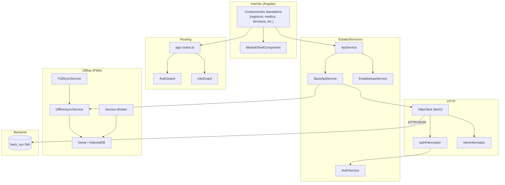
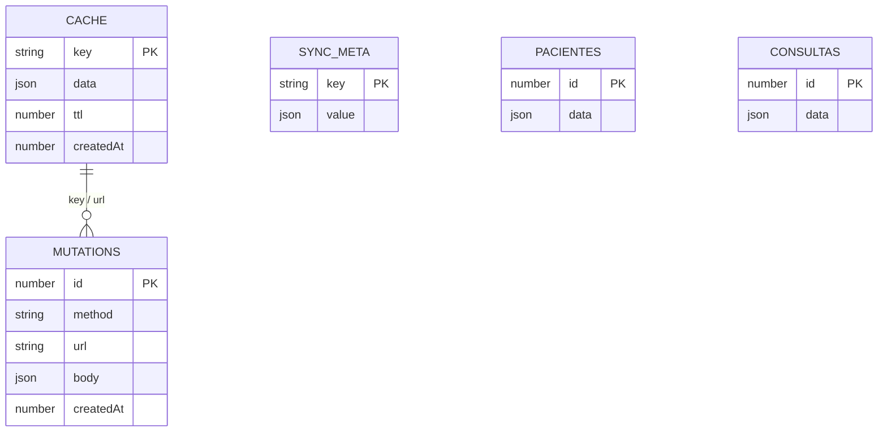
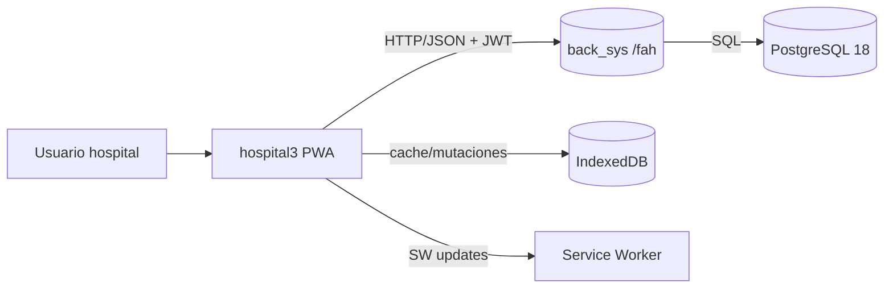
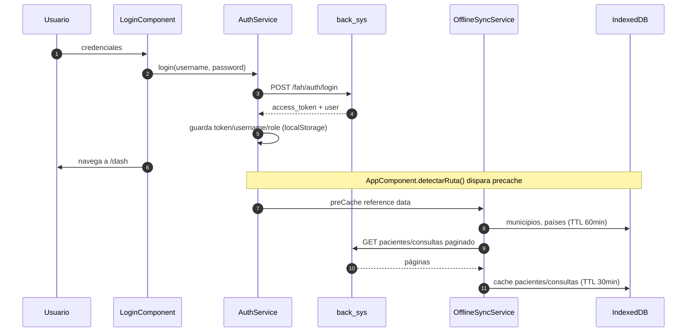
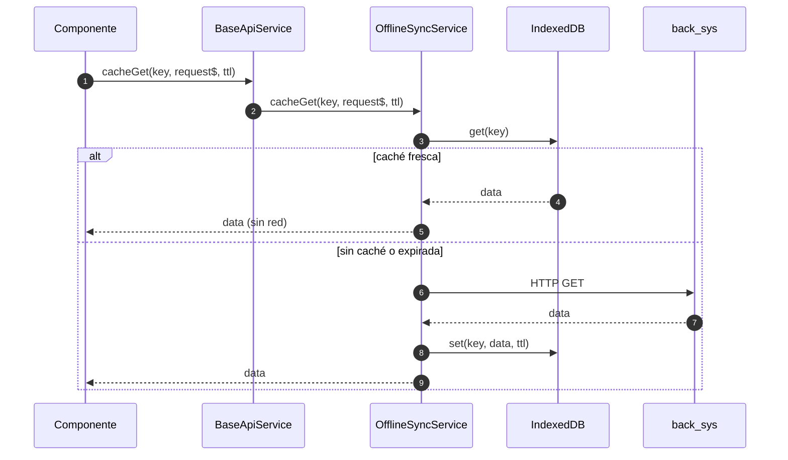
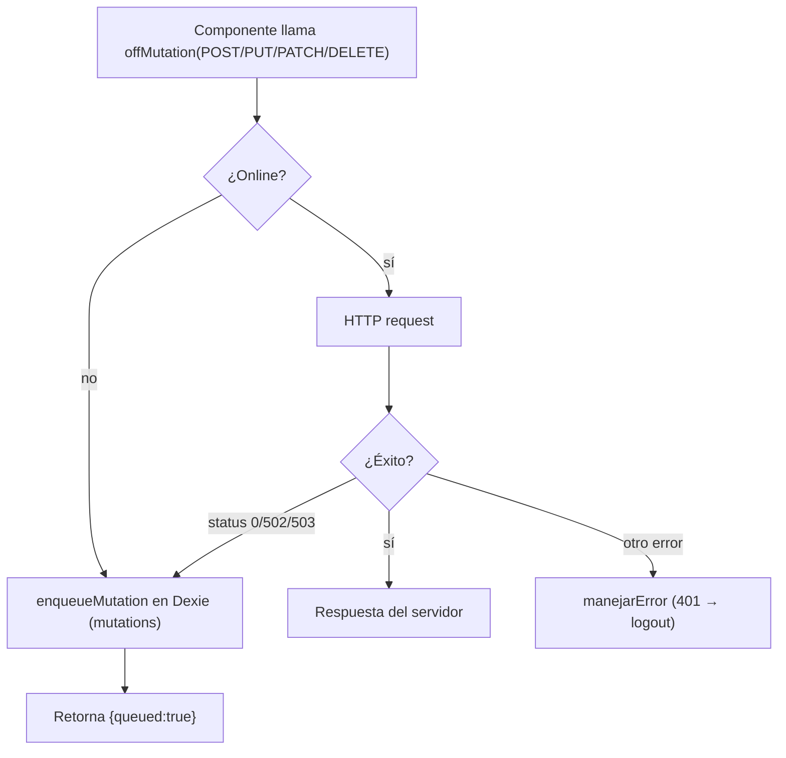
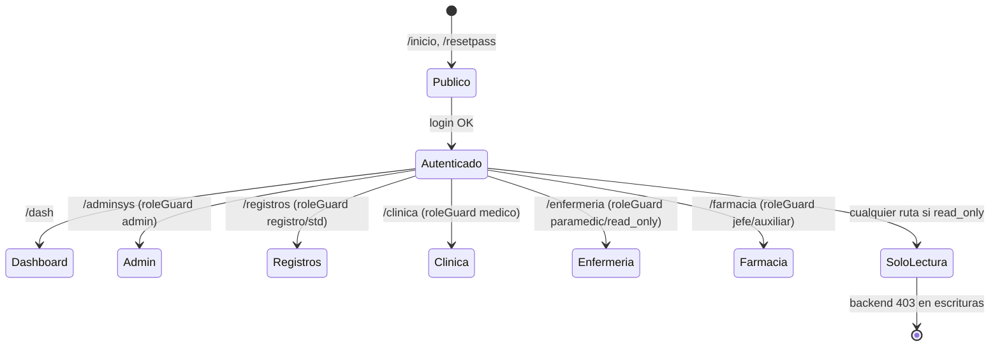

# Arquitectura del frontend `hospital3` (Angular 22 PWA)

> Documento generado con el skill `code-architect-documenter` (modo **Completo**, alcance **sistema completo**).
> Fuente de verdad: código real del repositorio (`src/main.ts`, `src/app/app.routes.ts`, `src/app/service/*`, `AGENTS.md`). Las inferencias se marcan `[Inferido]`.

---

## 0. Metadatos

| Campo | Valor |
|---|---|
| Sistema | `hospital3` — frontend PWA del Sistema FAH |
| Framework | Angular 22 (standalone components) |
| Lenguaje | TypeScript 5.8 (strict) |
| Estilos | CSS + PostCSS + PurgeCSS + Autoprefixer |
| Estado | Angular Signals + RxJS BehaviorSubject |
| Offline | Angular Service Worker + Dexie.js (IndexedDB) |
| Build | Vite/esbuild vía Angular CLI |
| Package manager | pnpm |
| Backend consumido | `back_sys` (FastAPI), base `https://www.htecpan.com/fah` (dev `http://localhost:8000/fah`) |
| Versión Angular | ^22.0.6 |

---

## 1. Comentarios de código inteligentes (fragmentos clave)

### 1.1 `main.ts` — bootstrap y políticas de reintento

```typescript
// El reintento se limita a GET y el interceptor de autenticación añade el JWT;
// ninguna escritura se repite automáticamente para evitar duplicar operaciones.
bootstrapApplication(AppComponent, {
  providers: [
    provideHttpClient(withFetch(), withInterceptors([retryInterceptor, authInterceptor])),
    provideRouter(routes, withPreloading(PreloadAllModules)),
    provideServiceWorker('ngsw-worker.js', { enabled: !isDevMode(), registrationStrategy: 'registerWhenStable:3000' }),
  ],
});
```

### 1.2 `base-api.service.ts` — encolado offline de mutaciones

```typescript
protected offMutation(method, url, body): Observable<any> {
  // `queued` no equivale a confirmación del servidor: la mutación queda
  // pendiente de sincronización cuando se recupera la conexión.
  if (!this.sync.isOnline()) {
    this.sync.enqueueMutation(method, url, body);
    return of({ queued: true, mensaje: 'Guardado localmente, se sincronizará cuando haya conexión' });
  }
  ...
}
```

### 1.3 `auth.guard.ts` — expiración local del JWT

```typescript
canActivate(): boolean {
  // Esta comprobación de expiración evita navegar con credenciales vencidas;
  // la autorización real y la firma del token se validan en el backend.
  const payload = JSON.parse(atob(token.split('.')[1]));
  if (payload.exp && payload.exp < now) { ... }
}
```

### 1.4 `role.guard.ts` — rol read-only

```typescript
// El rol de solo lectura puede ingresar a cualquier módulo para ver,
// pero no puede editar/crear/eliminar (backend retorna 403).
if (rolUsuario === 'read_only') return true;
```

### 1.5 `api.service.ts` — precarga secuencial de pacientes/consultas

```typescript
private preCachePageSequentially(url, skip, limit, total, ttl): void {
  // Descarga página por página para no saturar la red ni el IndexedDB;
  // se detiene si se cancela la precarga o se alcanza el total.
  if (skip >= total || this.precacheCancelado) return;
  ...
}
```

---

## 2. Resumen de diseño y arquitectura

### 2.1 Contexto y responsabilidad

`hospital3` es la aplicación web (PWA) que consumen los usuarios del hospital: recepción, registros médicos, médicos, enfermería, nutrición, odontología, trabajo social, UISAU, farmacia y administración. Cubre registro de pacientes, consultas (COEX, emergencia, hospitalización), admisiones, citas, nacimientos/defunciones, censo de camas, procedimientos, SIGSA-3, reportes/estadísticas, préstamos de expedientes y gestión de insumos. Funciona **offline-first**: caché en IndexedDB y cola de mutaciones sincronizadas al reconectar.

### 2.2 Patrón arquitectónico

**SPA Angular standalone + offline-first PWA.** No hay NgModules por feature; cada componente es `standalone` y se carga con `loadComponent` (lazy). La navegación se agrupa por dominio mediante `ModuleShellComponent` (barra lateral) y guards (`AuthGuard`, `roleGuard`). El estado compartido vive en servicios singleton (`ApiService`, `AuthService`, `OfflineSyncService`) usando Signals y BehaviorSubject. `[Inferido]` No hay store central (NgRx); el estado se deriva de servicios y caché local.

### 2.3 Stack tecnológico

- **Framework:** Angular 22 (standalone components).
- **Lenguaje:** TypeScript 5.8 strict.
- **Estado:** Angular Signals + RxJS BehaviorSubject.
- **HTTP:** `HttpClient` con fetch + interceptores (`retryInterceptor`, `authInterceptor`).
- **Offline:** Angular Service Worker (`ngsw-worker.js`) + Dexie.js (IndexedDB).
- **Estilos:** CSS con tokens (`_tokens.css`) + PostCSS + PurgeCSS + Autoprefixer.
- **Build:** Vite/esbuild vía Angular CLI; preloading `PreloadAllModules`.
- **Package manager:** pnpm.

### 2.4 Tabla de componentes (capas)

| Componente / Módulo | Capa | Responsabilidad | Depende de | Ubicación |
|---|---|---|---|---|
| `AppComponent` | Presentación/Shell | Raíz, navegación global, sync inicial, precache | ApiService, OfflineSync, FullSync | `src/app/app.component.ts` |
| `main.ts` | Bootstrap | Providers HTTP/router/SW, interceptores | app.routes | `src/main.ts` |
| `app.routes.ts` | Routing | ~100+ rutas lazy, guards por rol | guards, componentes | `src/app/app.routes.ts` |
| `AuthGuard` | Seguridad | Bloquea rutas sin token/JWT expirado | localStorage | `src/app/guards/auth.guard.ts` |
| `roleGuard` | Seguridad | Permite roles (+ read_only siempre) | AuthService | `src/app/role.guard.ts` |
| `authInterceptor` | HTTP | Añade `Authorization: Bearer` | AuthService | `src/app/service/auth.interceptor.ts` |
| `retryInterceptor` | HTTP | Reintenta GET ante fallos transitorios | — | `src/app/service/retry.interceptor.ts` |
| `ApiService` | Datos/API | Fachada de endpoints, caché, mutaciones | BaseApiService, EstadisticasService | `src/app/service/api.service.ts` |
| `BaseApiService` | Datos/API | Base HTTP, caché, `offMutation`, errores | OfflineSync, AuthService | `src/app/service/base-api.service.ts` |
| `AuthService` | Estado/Auth | Token, username, role, login/logout | HttpClient | `src/app/service/auth.service.ts` |
| `OfflineSyncService` | Offline | Dexie cache, mutation queue, online status | OfflineDatabase | `src/app/service/offline-sync.service.ts` |
| `OfflineDatabaseService` | Offline | Schema IndexedDB y operaciones | Dexie | `src/app/service/offline-database.service.ts` |
| `FullSyncService` | Offline | Sincronización completa al login | OfflineSync | `src/app/service/full-sync.service.ts` |
| `EstadisticasService` | Datos/API | Reportes/estadísticas | BaseApi | `src/app/service/estadisticas.service.ts` |
| `ModuleShellComponent` | Presentación | Barra lateral por módulo | module-nav | `src/app/shared/module-shell/` |
| `PWA (banner/update)` | Infraestructura | Estado offline y actualización SW | SW | `src/app/pwa/` |

### 2.5 Flujo de control general

1. `main.ts` arranca la app con `HttpClient` (fetch), router con precarga total y Service Worker (solo prod).
2. El usuario navega a `/inicio` (público) o a rutas protegidas; `AuthGuard` valida token y expiración local.
3. `roleGuard` valida rol contra la lista permitida (`read_only` siempre entra).
4. `authInterceptor` añade `Authorization: Bearer <jwt>` a cada petición; `retryInterceptor` reintenta GET transitorios.
5. El componente llama a `ApiService`/servicios de dominio; `BaseApiService.cacheGet` consulta IndexedDB y, si no hay caché fresca, ejecuta HTTP.
6. Las escrituras pasan por `offMutation`: si está offline o falla la red (0/502/503), se encolan en Dexie (`mutations`) y se devuelve `{ queued: true }`.
7. Al reconectar, `OfflineSyncService` procesa la cola; al navegar autenticado, `AppComponent` dispara precarga de pacientes/consultas y referencias.

### 2.6 Decisiones de diseño (ADR cortos)

- **ADR-1: Standalone components + lazy loading.**
  - Contexto: app grande con muchos módulos por rol.
  - Decisión: componentes standalone cargados con `loadComponent`.
  - Consecuencias: bundles por ruta y tree-shaking; más verbosidad en `app.routes.ts` (1000+ líneas).

- **ADR-2: Offline-first con IndexedDB (Dexie).**
  - Contexto: conectividad intermitente en el hospital.
  - Decisión: caché con TTL + cola de mutaciones.
  - Consecuencias: UX resiliente; riesgo de datos stale y conflictos de sincronización (`queued` no es confirmación).

- **ADR-3: Reintento solo en GET.**
  - Contexto: evitar duplicar escrituras.
  - Decisión: `retryInterceptor` limitado a GET; mutaciones no se reintentan automáticamente.
  - Consecuencias: seguridad de idempotencia; el usuario debe reintentar manualmente si falla una escritura online.

- **ADR-4: Rol `read_only` de solo lectura en frontend.**
  - Contexto: integraciones externas (CRM) que consultan sin modificar.
  - Decisión: el guard permite entrada a todo; el backend devuelve 403 en escrituras.
  - Consecuencias: UX consistente; la protección real está en el backend.

### 2.7 Seguridad y operación

- **Auth:** token JWT en `localStorage` (`access_token`, `username`, `role`); `AuthService` centraliza login/logout.
- **Guards:** `AuthGuard` (token + expiración local), `roleGuard` (roles + read_only).
- **HTTP:** interceptores para JWT y reintentos; 401 en `manejarError` dispara logout.
- **PWA:** Service Worker solo en producción; registro cuando estable (3 s).
- **Offline:** IndexedDB (`cache`, `mutations`, `syncMeta`, `pacientes`, `consultas`); precache de departamentos/países (TTL 60 min) y pacientes/consultas (TTL 30 min, hasta 5000 registros).
- **Build/Deploy:** `pnpm build` → `dist/medicapp/browser`; `deploy.sh` copia a `/var/www/medicapp`, ajusta permisos nginx y recarga.

---

## 3. Grafo de interconexión y modelo de datos (frontend)

### 3.1 Diagrama de componentes por capas



### 3.2 Modelo de datos local (IndexedDB / Dexie)



> El schema real de Dexie se define en `OfflineDatabaseService` (IndexedDB). `[Inferido]` los campos anteriores son los nombres lógicos observados en `api.service.ts`/`base-api.service.ts`.

### 3.3 Contexto del sistema



---

## 4. Procesos, secuencias y estados

### 4.1 Login y precarga



### 4.2 Lectura con caché offline



### 4.3 Escritura offline (cola de mutaciones)



### 4.4 Navegación por roles (stateDiagram)



---

## 5. Deuda técnica, riesgos y observaciones

| # | Hallazgo | Evidencia | Severidad |
|---|---|---|---|
| 1 | `app.routes.ts` monolítico (~1150 líneas) con rutas duplicadas/alias (`notasMedica` vs `notaMedica`) | `src/app/app.routes.ts` | Media |
| 2 | Estado disperso (Signals + BehaviorSubject) sin store central; riesgo de inconsistencias | `api.service.ts`, `auth.service.ts` | Media |
| 3 | `queued` no equivale a confirmación del servidor; mutaciones pueden fallar al sincronizar sin feedback claro | `base-api.service.ts` | Alta |
| 4 | Precache secuencial de hasta 5000 pacientes/consultas puede consumir memoria/red | `api.service.ts` (`precacheMaxRegistros`) | Media |
| 5 | Token y rol en `localStorage` (XSS) | `auth.guard.ts`, `auth.service.ts` | Media |
| 6 | Service Worker solo en prod; en dev no se prueba offline | `main.ts` | Baja |
| 7 | Alias `@enums/*`, `@shared/*` etc. definidos pero uso inconsistente | `tsconfig.json` | Baja |
| 8 | Role `read_only` entra a todo en frontend pero backend 403; UX puede confundir | `role.guard.ts` | Baja |
| 9 | Rutas públicas de backend (`/encamamiento`, `/municipios`) consumidas sin auth | `api.service.ts` | Baja |
| 10 | `environment.apiUrl` hardcodeado por entorno; revisar configuración prod | `environments/` | Baja |

---

## 6. Guía rápida de lectura (onboarding)

**Por dónde empezar (en orden):**

1. `src/main.ts` — bootstrap, providers, interceptores, SW.
2. `src/app/app.routes.ts` — rutas, guards, módulos.
3. `src/app/guards/auth.guard.ts` + `src/app/role.guard.ts` — seguridad de navegación.
4. `src/app/service/auth.service.ts` + `base-api.service.ts` + `api.service.ts` — auth, HTTP, caché, mutaciones.
5. `src/app/service/offline-sync.service.ts` + `offline-database.service.ts` — IndexedDB y cola.
6. `src/app/app.component.ts` — precarga y sync inicial.
7. `src/app/shared/module-shell/` — navegación por módulo.

**Cómo ejecutar y probar localmente:**

```bash
cd hospital3
pnpm install
pnpm start          # http://localhost:4200
pnpm build          # producción → dist/medicapp/browser
pnpm test           # Jasmine/Karma
```

**Glosario de dominio (frontend):**

- **PWA / SW:** aplicación instalable con Service Worker y caché.
- **Offline-first:** lectura desde IndexedDB; escrituras encoladas.
- **ModuleShell:** contenedor con barra lateral por módulo (registros, medica, etc.).
- **roleGuard:** permite roles listados; `read_only` siempre entra.
- **Precache:** descarga anticipada de pacientes/consultas/referencias al autenticarse.
- **`queued`:** mutación guardada localmente, pendiente de sincronización.

**Preguntas abiertas / `[Por confirmar]`:**

- ¿El Service Worker está habilitado en producción y probado offline? `[Por confirmar]`
- ¿Existe manejo de conflictos al sincronizar mutaciones encoladas? `[Por confirmar]`
- ¿La precarga de 5000 registros se usa en todos los roles o solo en algunos? `[Por confirmar]`
- ¿Hay pruebas E2E (Cypress/Playwright) además de Karma? `[Por confirmar]` (solo se observan specs unitarios).